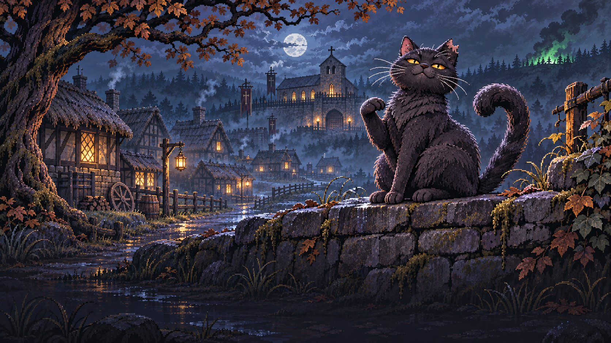

# The Light in the Darkness

**Demo narrativa 0.2: Oakhaven y la llegada a Londinium.**



Los paquetes de Windows y Web están en [Releases](https://github.com/AI-Innovation-op/The-Light-in-the-Darkness/releases). En Windows, extrae el ZIP y abre `TheLightInTheDarkness.exe`. Para navegador, sirve el contenido del ZIP web mediante HTTP; abrir `index.html` con doble clic no permite cargar WebAssembly.

Godot 4.7.2 estable, GDScript y renderizador Compatibility. Plataforma de esta entrega: Windows x86-64 y navegador de escritorio con teclado y ratón.

## Jugar

1. Lee las cuatro páginas de Shalem o salta la apertura con Esc. Enter, Espacio o el botón permiten avanzar y revelar el texto.
2. Elige Thomas o Khaterine y habla con Elowen junto al huerto usando E.
3. Avanza hacia la derecha y supera un acechador y una oleada de tres.
4. Puedes usar el acceso ganado para resolver cuatro parejas de Shalem; es opcional para continuar la historia.
5. Continúa hacia el bosque y enfrenta el prototipo de Morwenna, con incensario y piras señaladas.
6. Después de su retirada, ve al extremo derecho y pulsa E para revisar pendientes y partir.
7. Tres ilustraciones cuentan el viaje. Al terminarlas o saltarlas, se guarda la llegada y se entra a una zona explorable de Londinium.

El resto del Acto II y la Catedral todavía están pendientes de producción.

Thomas es más rápido y frágil; Khaterine es más lenta, resistente y puede lanzar magia. El personaje que no controlas sigue al protagonista y ayuda en combate. Tab cambia entre los dos.

Nueva partida inicia otro recorrido y sustituye el checkpoint. Continuar partida conserva los objetivos ya completados.

| Control | Acción |
| --- | --- |
| WASD o flechas | Moverse por el suelo |
| J / K | Ataque ligero / fuerte |
| L | Mantener guardia; el inicio del bloqueo permite un parry |
| Espacio | Esquiva con invulnerabilidad breve |
| Q | Lanzar el arma; queda disponible para recuperar |
| E | Conversar, recuperar el arma propia o interactuar con Shalem |
| Tab | Cambiar protagonista |
| Escape | Pausar o salir de la memoria conservando el acceso |
| I | Abrir o cerrar el diario de historia |
| Enter y Tab en menús | Confirmar y recorrer controles con foco visible |

Durante el relato, Enter/Espacio revelan el texto o avanzan y Esc permite saltar. Las voces todavía no están grabadas. El diario permite repetir las secuencias desbloqueadas y separa los cuatro hitos de cada acto de la XP y los accesos de Shalem. Los objetivos futuros se ocultan para preservar el misterio.

Los ataques pesados y la rotura de guardia pueden desarmarte. Puedes combatir a puños y recuperar tu arma con E. El combate y la IA se detienen durante conversaciones, pausa y memoria.

## Ejecutar desde fuentes

Importa `project.godot` en Godot 4.7.2 estable y pulsa F6 sobre `main.tscn`, o F5 para ejecutar el proyecto. El proyecto no necesita plugins ni paquetes npm. El audio provisional se sintetiza al iniciar; no requiere descargas.

Para las pruebas por CLI, usando la ruta a tu ejecutable de Godot:

```powershell
godot --headless --path . --script res://tests/domain_tests.gd
godot --headless --path . --fixed-fps 60 --script res://tests/integration_tests.gd
python tools/check_architecture.py
```

El laboratorio de pruebas escribe archivos de prueba con nombres separados del guardado normal. La integración recorre una sesión de juego de prueba y escribe su checkpoint. Ejecuta pruebas con un perfil de datos aislado si quieres preservar tu partida de desarrollo.

## Construcción reproducible

`tools/build.py` acepta la carpeta del motor y una carpeta de salida explícita situada fuera del proyecto. Copia el proyecto a esa carpeta, importa recursos, ejecuta las pruebas y exporta Windows y Web. Rechaza una salida dentro de las fuentes para evitar copias recursivas.

```powershell
python tools/build.py --runtime RUTA_AL_RUNTIME --output RUTA_DE_SALIDA
python tools/verify_native.py --runtime RUTA_AL_RUNTIME --build RUTA_DE_SALIDA
python tools/serve.py --web RUTA_DE_SALIDA/web --evidence RUTA_DE_SALIDA/evidence
```

El runtime utilizado contiene `Godot_v4.7.2-stable_win64_console.exe`, su ejecutable principal y `web_release.zip`, la plantilla oficial **sin hilos**. Si falta la plantilla Windows, el script obtiene `windows_release_x86_64.exe` del paquete oficial mediante rangos HTTP. La extracción valida el CRC del ZIP; el manifiesto del artefacto registra hashes locales. El editor utilizado fue comprobado contra la suma SHA-512 oficial durante la evaluación técnica.

La dirección local es `http://127.0.0.1:8766/`. El servidor acepta solo datos de prueba en este equipo y se detiene con Ctrl+C. La compilación web de revisión incluye la característica `playtest`: envía estado técnico al servidor **solo en localhost**. Para distribuir una versión pública, quitar esa característica del preset. No existe un servicio externo de telemetría.

## Arquitectura y estado

[Arquitectura y decisiones](docs/ARCHITECTURE.md) describe el DDD aplicado, los límites y la dirección de dependencias. Las reglas de daño, guardia, progresión y memoria se prueban sin cargar una escena. El guardado se conecta mediante un adaptador inyectado.

El checkpoint conserva personaje elegido, conversación completada, encuentro resuelto, Morwenna retirada, llegada a Londinium, acceso, recompensa y ajustes. Al continuar se restaura un punto seguro; no se guardan proyectiles en vuelo, posiciones exactas ni salud del combate interrumpido. El guardado usa un archivo temporal y una copia de respaldo de la última versión válida. Su recuperación se prueba con un archivo corrupto.

Morwenna no completa el Acto I por sí sola: la llegada guardada a Londinium resuelve el cuarto hito. Repetir una secuencia no concede progreso adicional. La regla del futuro Acto II requiere la huida de Malphas; vaciar su barra en la falsa victoria no basta. Ese combate todavía no está implementado.

Si falla el guardado de la recompensa, la reclamación se revierte en memoria y se conserva el acceso. La interfaz ofrece reintentar la escritura. En este entorno restringido, el editor emitió `Safe save failed` al guardar su configuración durante importación/exportación; los paquetes se generaron, las pruebas de guardado del juego pasaron y el ejecutable inició sin errores de runtime. No se desactivaron protecciones del equipo.

## Alcance de la versión 0.1

Esta entrega es una base funcional de la demo. El arte de combate se dibuja con formas de pixel art provisionales; las animaciones y el audio todavía necesitan producción artística. Los efectos sintetizados no son las voces, coros ni música final del guion. El Recuerdo del Roble es una recompensa de prueba, sin sustituir el catálogo de armas de la biblia. Morwenna es un prototipo para comprobar combate, cierre y transición; todavía no implementa el arma Lamento de Oakhaven.

Quedan para siguientes entregas Malphas y Astaroth, la campaña completa, las cinco misiones narrativas, el arsenal y sus efectos completos, puzzles y trivia, remates cooperativos, armas enemigas temporales, cooperativo local, mando, rebinding, voces y música final. La demo actual tiene memoria de cuatro parejas, un compañero sencillo y dos personajes controlables por turnos.

Las pruebas automatizadas verifican reglas y el recorrido determinista; no certifican 60 FPS, calidad del sonido ni jugabilidad con mando. Las pruebas con servidor de audio desactivado omiten la reproducción. La validación de navegador cubre movimiento, diálogo, cambio de personaje, pausa, ajustes y recarga. La cadencia puede limitarse al pasar el navegador a segundo plano.

La narrativa principal procede de la **Edición Maestra** actualizada y del **Guion técnico de sonido y diálogos** proporcionados por Kevin el 13 de noviembre de 2026. La apertura y el enlace entre escenarios son adaptaciones propuestas para esta demo. La profecía citada al inicio es la versión oficial difundida por la Iglesia: conserva el misterio de Thomas.

Las cuatro ilustraciones se generaron con la herramienta integrada **image_gen**, usando la dirección visual de Kevin como referencia. Se conservan los [prompts](assets/cinematics/prompts.json) y las imágenes: [Shalem](assets/cinematics/shalem-opening.png), [Oakhaven](assets/cinematics/oakhaven-aftermath.png), [el camino](assets/cinematics/road-to-londinium.png) y [Londinium](assets/cinematics/londinium-gates.png).

GitHub Actions ejecuta arquitectura, reglas y escenas en cada push y pull request. `tools/ci_validate.py` descarga el motor oficial y comprueba su SHA-512, o acepta `--godot` para usar una instalación existente. Los tests se ejecutan con un perfil aislado.

Godot se distribuye bajo licencia MIT: [licencia del motor](https://godotengine.org/license/). Las distribuciones empaquetadas incluyen sus avisos de licencia. Este proyecto conserva los conceptos y textos originales de Kevin.
